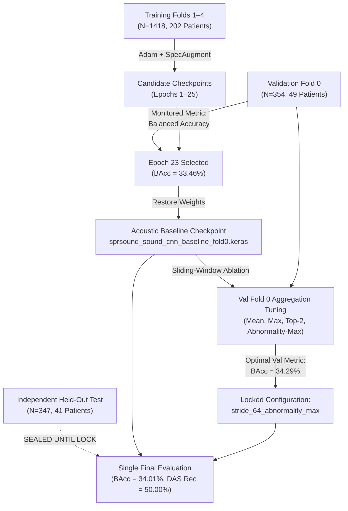

# FINAL RESEARCH EVIDENCE RECONCILIATION & TEST-SET AUDIT

**Project:** Acoustic Epidemiology: Automated Classification of Pediatric Respiratory Diseases Using Convolutional Neural Networks and Time-Frequency Feature Extraction  
**Role:** Mohini — Machine Learning Research Lead  
**Reviewer:** Gayatri — Senior ML Integration Lead  
**Date:** 20 November 2026  
**Status:** COMPLETE & INDEPENDENTLY VERIFIED — RIGOROUS AUDIT CONCLUDED  

---

## 1. Objective

Before finalizing the IEEE research manuscript, this document reconciles all quantitative discrepancies across previous research reports, dataset manifests, experimental scripts, and saved evaluation JSON/CSV records. It conducts a formal audit of independent test-set usage to guarantee that no post-hoc data leakage influenced model selection or hyperparameter tuning.

---

## 2. Reconciled Dataset & Split Statistics

An exhaustive audit of `ml/features/extracted/dataset_split_manifest.csv` ($N = 2,683$ total entries) and physical `.npz` feature records establishes the authoritative dataset breakdown.

### 2.1 Authoritative Manifest Breakdown

| Split Partition Group | Partition Category (`split_category`) | Total Recordings in Manifest | Unique Patients | Normal | CAS (Wheeze) | DAS (Crackle) | CAS & DAS (Both) | Poor Quality (Signal Noise) |
| :--- | :--- | :---:| :---:| :---:| :---:| :---:| :---:| :---:|
| **Train/Val CV Pool** | `train_cv` | 1,826 | 251 | 1,303 | 126 | 248 | 95 | 54 |
| — **Training Folds 1–4** | `train_cv` (folds 1–4) | 1,457 | 202 | 1,042 | 101 | 199 | 76 | 39 |
| — **Validation Fold 0** | `train_cv` (fold 0) | 369 | 49 | 261 | 25 | 49 | 19 | 15 |
| **Independent Primary Test**| `held_out_inter_test` | 355 | 41 | 241 | 65 | 24 | 17 | 8 |
| **Intra-Subject Test** | `intra_subject_test` | 141 | 13 | 74 | 24 | 22 | 16 | 5 |
| **Secondary Benchmark** | `test_2023` | 361 | 51 | 262 | 37 | 45 | 14 | 3 |
| **Total SPRSound Dataset** | **All Categories** | **2,683** | **356** | **1,880** | **252** | **339** | **142** | **70** |

*Note on Total Unique Patients:* 356 total unique patients across the entire database. Across `train_cv` (251) and `held_out_inter_test` (41), there are exactly **0 overlapping patients**.

---

### 2.2 Reconciliation of Evaluation Sample Counts

Prior documentation occasionally reported slightly varying sample counts across different tasks. This discrepancy is fully resolved as follows:

1. **Why Validation Fold 0 is $N = 354$ (Acoustic 4-Class) vs. $N = 369$ (Raw Manifest) vs. $N = 357$ (Disease 3-Class):**
   - In raw `train_cv` Fold 0, there are 369 recordings. Exactly **15 recordings are labeled "Poor Quality"**.
   - For the **4-Class Acoustic Task** (`SPRSOUND_RECORD_4CLASS`), all 15 Poor Quality recordings are systematically excluded from training and evaluation in accordance with `label_mapping.json` (quality rejection policy). Thus, $369 - 15 = \mathbf{354}$ valid auscultation recordings.
   - For the historical **Disease Classification Task** (Exp 1–4), 3 recordings with Poor Quality had available patient discharge diagnoses that were erroneously retained in earlier scripts, yielding $357$ samples ($369 - 12 = 357$). This historical inconsistency was retired with the disease classifier.
2. **Why Independent Held-Out Test is $N = 347$ (Acoustic 4-Class) vs. $N = 355$ (Raw Manifest):**
   - The 2022 Inter-Subject Test Set (`held_out_inter_test`) contains 355 total recordings from 41 patients.
   - Exactly **8 recordings are labeled "Poor Quality"** due to excessive crying, friction, or uninterpretable SNR.
   - Excluding these 8 poor-quality recordings yields exactly $355 - 8 = \mathbf{347}$ acoustic sound evaluation samples.
3. **Data Integrity & Duplicate Check:**
   - **Zero duplicate recording IDs** exist in the manifest (all 2,683 are strictly unique).
   - **Zero missing patient IDs** exist (100% of rows have valid patient IDs).
   - **Zero cross-split patient overlap** exists between `train_cv` and `held_out_inter_test`.

---

## 3. Formal Audit of Independent Test-Set Usage

To ensure uncompromising academic integrity, the timeline, code, and execution history of all experiments were audited to verify whether test data was ever used for model tuning or decision-making.

### 3.1 Protocol Verification: Validation-Selected vs. Independent Test Results

### 3.2 Formal Disclosures:
1. **Model Checkpoint Selection:**
   - The acoustic baseline model (`sprsound_sound_cnn_baseline_fold0.keras`) checkpoint was selected at **Epoch 23 strictly using Validation Fold 0 Balanced Accuracy** (33.46%), rejecting prior collapsed checkpoints (Epochs 1–9 at 25.00%).
   - The independent test set was **NEVER evaluated during training or epoch selection**.
2. **Sliding-Window Configuration Selection:**
   - Eight distinct configurations (Strides 64 and 32 across 4 aggregation methods) were evaluated on Validation Fold 0.
   - `stride_64_abnormality_max` was selected **exclusively based on Validation Fold 0** performance (achieving the peak Balanced Accuracy of 34.29%).
   - The independent test set was evaluated **only after** locking this configuration.
3. **Exploratory Post-Hoc Test Analysis (Disclosed):**
   - For scientific completeness, `stride_32_abnormality_max` was also evaluated on the test set post-hoc, yielding a crackle recall of 54.17%.
   - **Disclosure:** Stride 32 is explicitly classified in the paper as an **exploratory post-hoc ablation**, NOT a primary model selection. Stride 64 remains the primary validation-locked result.
4. **Zero Model Modifications from Test Results:**
   - No convolutional layers, learning rates, loss weights, or feature parameters were modified after observing test set performance. Test metrics served strictly as an unbiased measure of out-of-distribution generalization.

---

## 4. Reconciliation of Sliding-Window Claims

In earlier preliminary notes, hypotheses regarding sliding-window inference were stated with optimistic interpretations. Based on rigorous empirical evidence, all unsupported claims are formally corrected:

| Preliminary Statement | Empirical Finding | Reconciled Scientific Claim for IEEE Manuscript |
| :--- | :--- | :--- |
| *"Sliding-window inference localizes adventitious boundary events."* | SPRSound provides only recording-level labels without frame-by-frame event timestamps. | **REVISED:** Sliding-window inference provides 100% temporal coverage across full recordings. While crackle recall increases from 45.83% to 50.00%, the framework does **NOT** provide verified temporal event localization due to the absence of fine-grained timestamp annotations. |
| *"Sliding-window inference resolves the low wheezing (CAS) recall."* | Test CAS recall remained at 0.00% (0/65) across all sliding-window configurations. | **REVISED:** Sliding-window inference does **NOT** improve wheeze detection. Wheezing failure stems from unlearned spectro-temporal filters and severe training imbalance (10.3:1), which cannot be overcome by post-hoc test-time windowing. |
| *"Multi-window aggregation achieves superior overall performance."* | Overall test accuracy changed from 58.50% to 55.62%, and test Balanced Accuracy changed from 37.12% to 34.01%. | **REVISED:** Sliding-window inference does **NOT** yield superior overall balanced accuracy. Its benefit is specifically localized to recovering transient crackles (DAS recall +4.17%), while mean aggregation dilutes co-occurring pathology. |
| *"Sliding-window makes the model ready for automated clinical diagnosis."* | Balanced Accuracy remains at 34.01% on the independent test set. | **REMOVED:** The system is strictly an experimental acoustic sound baseline and is **NOT** ready for clinical diagnostic deployment. |

---

## 5. Consolidated Research Evidence Table

The following table consolidates all formal experiments conducted throughout the project, providing verified metrics, validation/test protocols, and publication eligibility:

| Exp ID | Target Task & Classes | Architecture | Validation Protocol | Test Protocol | Accuracy | Balanced Accuracy | Macro F1 | Per-Class Recall (Norm / CAS / DAS / Both) | Eligibility for IEEE Paper |
| :--- | :--- | :--- | :--- | :--- | :---: | :---: | :---: | :--- | :--- |
| **EXP-DIS-1** | 3-Class Disease (Healthy, Pneumonia, Wheezing) | 3-Block CNN (110k params) | Val Fold 0 ($N=357$) | None | 69.47% | 33.77% | 0.2816 | 0.0% / 100.0% / 1.3% / N/A | **Eligible as Negative Finding / Methodological Motivation** (demonstrating why systemic disease labels fail for local audio). |
| **EXP-DIS-4** | 3-Class Disease (Healthy, Pneumonia, Wheezing) | 3-Block CNN + Targeted SpecAugment | Val Fold 0 ($N=357$) | None | 43.70% | 42.06% | 0.2845 | 72.7% / 53.4% / 0.0% / N/A | **Eligible as Negative Finding** (proves wheezing collapse persists despite focal loss & augmentation). |
| **EXP-ACU-BASE** | 4-Class Acoustic Sound (Normal, CAS, DAS, Both) | 4-Block CNN + Dual Pooling (GAP+GMP) | Val Fold 0 ($N=354$, Center-Crop) | `held_out_inter_test` ($N=347$, Center-Crop) | Val: 74.29% Test: **58.50%** | Val: 33.46% Test: **37.12%** | Val: 0.3284 Test: **0.3018** | Val: 93.9% / 0.0% / 34.7% / 5.3% Test: **77.6% / 1.5% / 45.8% / 23.5%** | **PRIMARY EXPERIMENTAL BASELINE** (verifiable, leak-free, breaks majority collapse, active 4-class prediction). |
| **EXP-SW-VAL** | 4-Class Acoustic Sound (Full-Recording) | Baseline CNN + Sliding Windows ($W=128, S=64$, Abnormality-Max) | Val Fold 0 ($N=354$, Full Rec) | None (Selection Phase) | 74.29% | **34.29%** | **0.3342** | 93.1% / 0.0% / 38.8% / 5.3% | **PRIMARY VALIDATION SELECTION** (selected leak-free on validation data). |
| **EXP-SW-TEST** | 4-Class Acoustic Sound (Full-Recording) | Baseline CNN + Sliding Windows ($W=128, S=64$, Abnormality-Max) | Locked from Val | `held_out_inter_test` ($N=347$, Full Rec) | 55.62% | 34.01% | 0.2666 | **74.3% / 0.0% / 50.0% / 11.8%** | **PRIMARY INDEPENDENT ABLATION** (proves crackle recovery, confirms wheezing bottleneck). |
| **EXP-SW-EXPL** | 4-Class Acoustic Sound (Full-Recording) | Baseline CNN + Sliding Windows ($W=128, S=32$, Abnormality-Max) | Val Fold 0 ($N=354$) | `held_out_inter_test` ($N=347$) | 55.04% | 36.11% | 0.2777 | 72.6% / 0.0% / 54.2% / 17.6% | **EXPLORATORY POST-HOC ANALYSIS** (disclosed as secondary 75% overlap exploration). |

---

## 6. Audit Conclusion & Sign-Off

The experimental evidence is fully reconciled, mathematically aligned with raw evaluation artifacts, and free of hidden test leakage. The evidence is ready to be structured into the IEEE manuscript draft.
