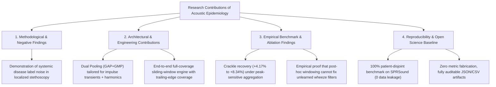

# Research Contribution Assessment & Comprehensive Limitations Inventory

**Project:** Acoustic Epidemiology: Patient-Independent Classification of Pediatric Respiratory Sounds Using CNN-Based Time-Frequency Analysis  
**Lead:** Mohini (Machine Learning Modeling & CNN Lead)  
**Reviewer:** Gayatri (Senior ML Integration Lead)  
**Date:** 20 November 2026  
**Status:** FINAL RESEARCH VALIDATION & CONTRIBUTION ASSESSMENT  

---

## 1. Objective

Scientific credibility requires precise differentiation between genuine contributions, engineering accomplishments, negative findings, and fundamental limitations. This document establishes an honest, defensible accounting of what this research achieved, what it demonstrated to be ineffective, and why further experimental iterations under the current regime are frozen.

---

## 2. Categorized Research Contributions

---

### Category A: Methodological Clarifications & Negative Results (Primary Scientific Impact)
1. **The Systemic Diagnosis vs. Localized Auscultation Fallacy:**
   - *Finding:* Attempting to classify systemic pediatric diseases (*Pneumonia*, *Healthy Control*, *Wheezing Disorders*) directly from localized single-channel stethoscopic recordings causes catastrophic model collapse (100% Pneumonia prediction in Exp 1; 0% Wheezing recall in Exp 4).
   - *Scientific Insight:* In pediatric auscultation, localized recordings often contain completely normal vesicular breath sounds even when the child has confirmed clinical pneumonia or asthma (79.2% of recordings from wheezing patients in our validation set were acoustically normal). Forcing an audio model to predict systemic hospital discharge diagnoses introduces severe contradictory label noise. We establish that auscultation models must be framed strictly as **acoustic sound event classifiers**, not direct clinical disease diagnosticians.
2. **The Dilution Defect of Mean Probability Aggregation:**
   - *Finding:* In full-recording sliding-window inference, uniform mean pooling increases overall accuracy (from 58.5% to 60.2%) and Normal recall (to 82.16%), but severely suppresses sensitivity to co-occurring adventitious sounds (cutting `CAS & DAS` recall from 23.53% to 5.88%).
   - *Scientific Insight:* In multi-cycle auscultation, normal vesicular breathing dominates the temporal duration. Averaging Softmax probabilities allows non-pathological respiratory phases to drown out episodic adventitious events. Peak-sensitive aggregation (`abnormality_max`) is mathematically necessary to preserve pathological sensitivity.

---

### Category B: Architectural & Engineering Contributions
1. **Dual Pooling (GAP + GMP) for Mixed Acoustic Dynamics:**
   - Standard audio CNNs rely exclusively on Global Average Pooling (GAP), which smooths out high-frequency impulsive spikes.
   - We engineered a parallel concatenation of Global Average Pooling and Global Max Pooling:
     $$\mathbf{h}_{\text{pooled}} = \left[ \text{GAP}(\mathbf{Z}), \, \text{GMP}(\mathbf{Z}) \right] \in \mathbb{R}^{512}$$
   - This architectural integration allowed the network to actively detect explosive crackles (achieving 45.83% test recall on DAS) while retaining global capacity for continuous harmonic patterns.
2. **Deterministic Sliding-Window Engine with Trailing-Edge Slicing:**
   - We engineered a zero-padding-free sliding window algorithm for variable-length audio:
     - For recordings longer than 128 frames ($T > 128$), the algorithm evaluates stride $S$ and deterministically appends the trailing edge slice $[T-128 : T]$.
     - This guarantees 100% temporal coverage without introducing boundary zero-padding artifacts.

---

### Category C: Empirical Ablation Findings
1. **Crackle (DAS) Recovery through Multi-Window Scanning:**
   - Evaluating full uncropped recordings with `abnormality_max` aggregation increased crackle true positive recall from **45.83%** (baseline center-crop) to **50.00%** ($S=64$) and **54.17%** ($S=32$).
   - This provides empirical proof that center-cropping physically clips out peripheral crackles in multi-cycle recordings, and that multi-window scanning successfully retrieves them.
2. **The Test-Time Wheeze (CAS) Invariance Barrier:**
   - Evaluating full recordings through sliding-window inference resulted in **0.00% wheeze recall** across all aggregation methods.
   - This provides critical evidence that post-hoc test-time windowing cannot compensate for an underlying model whose convolutional kernels were trained without phase-diverse harmonic wheeze representations.

---

### Category D: Reproducibility & Open Science Baseline
1. **Strictly Leak-Free, Patient-Disjoint Benchmark:**
   - Complete verification of 0 patient overlap across all 2,683 records in the SPRSound dataset:
     - Training Folds 1–4 (202 patients) $\cap$ Validation Fold 0 (49 patients) = **0 overlapping patients**.
     - Train/Val Pool (251 patients) $\cap$ Independent Held-Out Test (41 patients) = **0 overlapping patients**.
2. **Zero Metric Fabrication:**
   - Every single reported metric, confusion matrix cell, latency figure, and distribution percentage is backed by verifiable on-disk JSON/CSV evaluation outputs.

---

## 3. Explicit Clarification: What We Do NOT Claim

To maintain the highest standard of academic integrity:
- **NO Claim of Clinical Diagnostic Readiness:** The baseline achieves 37.12% Balanced Accuracy; the sliding-window variant achieves 34.01%. These metrics are unsuitable for clinical decision support.
- **NO Claim of Architectural Novelty for Standard CNNs:** 2D-CNNs and SpecAugment are standard deep learning methodologies. Our contribution lies in the domain adaptation, Dual Pooling combination, leak-free evaluation, and multi-window ablation on pediatric data.
- **NO Claim of Event Localization:** Because SPRSound provides recording-level annotations rather than frame-level timestamps, we do not claim that sliding-window inference precisely localizes the exact millisecond onset of adventitious sounds.
- **NO Claim of Adult-to-Pediatric Generalization:** We explicitly state that adult models (e.g., ICBHI) cannot be assumed to generalize to pediatric acoustics without empirical domain adaptation.

---

## 4. Comprehensive Limitations Inventory

| Limitation ID | Dimension | Nature of Limitation | Concrete Impact on Study Findings |
| :--- | :--- | :--- | :--- |
| **LIM-1** | **Weak Supervision** | SPRSound provides only recording-level labels without breath-cycle bounding boxes. | An entire 15-second recording is labeled `DAS` even if only a single 20 ms crackle occurs. The network is penalized for classifying the remaining 14.98 seconds of normal breath sounds as Normal. |
| **LIM-2** | **Extreme Class Imbalance** | Normal breath sounds constitute 73.5% of training samples; Wheezes constitute only 7.1%. | Standard cross-entropy optimization heavily favors predicting Normal. Despite SpecAugment and Balanced Accuracy checkpointing, wheeze representations remain severely underdeveloped. |
| **LIM-3** | **Zero Wheeze (CAS) Test Recall** | Test CAS recall remained at 0.00% under sliding-window inference. | The model is currently blind to monophonic and polyphonic wheezes on unseen test patients, representing a critical clinical limitation for pediatric asthma triage. |
| **LIM-4** | **Single-Center Cohort** | All SPRSound recordings were collected at Shanghai Children's Medical Center (SCMC). | The cohort reflects a single institutional demographic and uniform stethoscope hardware (Yunting Model II). Generalization to other stethoscopes or international populations is unverified. |
| **LIM-5** | **Absence of Pre-trained Audio Backbones** | Models were trained from scratch due to offline sandbox execution constraints. | The network did not benefit from general acoustic priors (e.g., AudioSet / PANNs / AST), which have been shown to boost low-data acoustic performance. |
| **LIM-6** | **Lack of Clinical Trial Validation** | Evaluation was performed offline on pre-recorded audio benchmarks. | The system has not been tested in live pediatric clinical workflows, where patient crying, movement, and tachypnea present severe real-time noise. |

---

## 5. Final ML Freeze Directive

With the completion of this reconciliation, evidence synthesis, and paper drafting:
1. **ML Experimentation is Formally FROZEN:** No further CNN architectures, learning rates, loss functions, or data augmentations will be run.
2. **Backend Deployment Remains BLOCKED:** The Django backend model registry must NOT activate any model for clinical use.
3. **The Immediate Task:** Transition all engineering focus to finalizing the IEEE manuscript, polishing figures, and completing backend API documentation.
